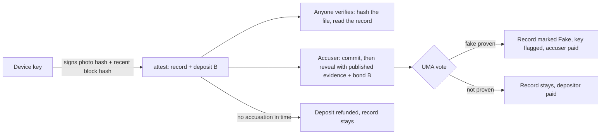

# Paprika

Paprika records the origin of photos on Ethereum. A device key signs each photo together with a recent block hash.
Each record carries a refundable deposit. Anyone can accuse a record with an equal bond, and UMA's open vote decides.

It answers Track 1 of [IXH26](https://www.decifris.it/ixh26/): *"Design a secure protocol that generalises to any
device and guarantees authentic photo origin via decentralised blockchains technology."*

## Three design constraints

The brief shows three weaknesses of a centralised design. Paprika takes each one as a constraint and meets it.

| Constraint | How Paprika meets it |
|---|---|
| No single point of failure | No manufacturer, no certificate authority, no central revocation list. Accusations are decided by UMA's open vote |
| No cross-platform lock-in | Any device with a P-256 key registers, free. Anyone verifies a file from public chain data |
| No retroactive censorship | Records are never erased. Every decision is recorded with its block |

## How it works



| Part | Role |
|---|---|
| [`Paprika.sol`](contract/contracts/Paprika.sol) | Holds records, deposits and bonds. Checks device signatures. Sends accusations to UMA. Has no owner |
| UMA | The Optimistic Oracle V3 holds the stakes of an accusation. UMA's vote (`VotingV2`) decides it |
| User wallet | MetaMask. Each user signs every transaction. No server holds a user key |
| Demo server ([`app/`](app/)) | Serves the web app, relays signed transactions, stores published evidence under its SHA-256 |

The full specification is in [docs/protocol.md](docs/protocol.md). The reason for each rule is in
[docs/design-rationale.md](docs/design-rationale.md).

## Quick start

Requirements: Node.js 26 or later, and MetaMask in the browser.

```bash
# contract tests, with UMA's oracle, UMA's vote and WETH on an in-process chain
cd contract && npm install && npx hardhat test && cd ..

# the demo: local chain, UMA's contracts, Paprika and the web app on http://localhost:5173/
cd app && npm install && npm start
```

MetaMask setup and the demo steps: [docs/demo.md](docs/demo.md).

## Repository map

| Path | Content |
|---|---|
| [`docs/`](docs/) | Protocol, design rationale, demo |
| [`contract/`](contract/) | [`Paprika.sol`](contract/contracts/Paprika.sol), its tests, the local deployment of UMA's contracts, the [case table](contract/output/cases.md) |
| [`app/`](app/) | Device library, chain client, command-line tool and web app |
| [`slides/`](slides/) | Pitch deck and speaker notes |
| [`AI_DISCLOSURE.md`](AI_DISCLOSURE.md) | Declaration of the use of AI tools |
| [`THIRD_PARTY.md`](THIRD_PARTY.md) | Third-party software and material, with licences |

## Team

Team **Sexy Plushies**: Francesco Lucibello, Vincenzo Imperati, Lorenzo Camilli.
