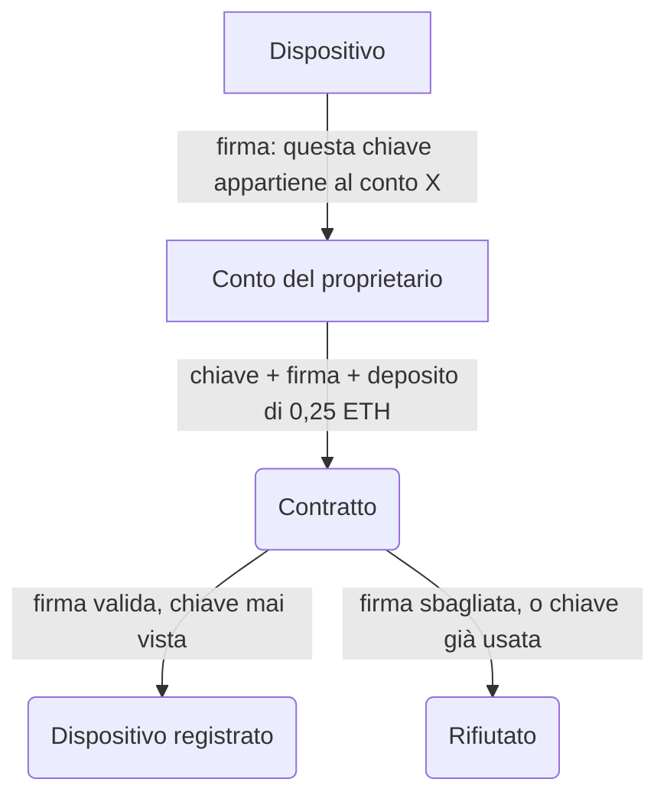
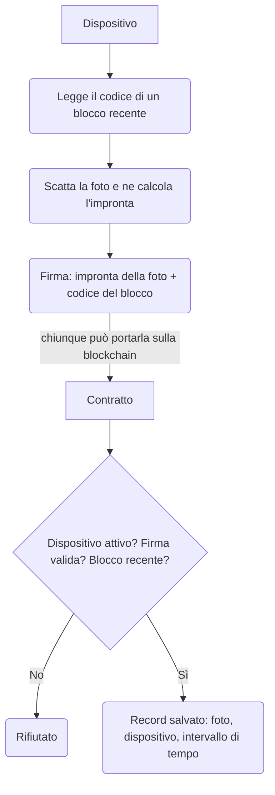
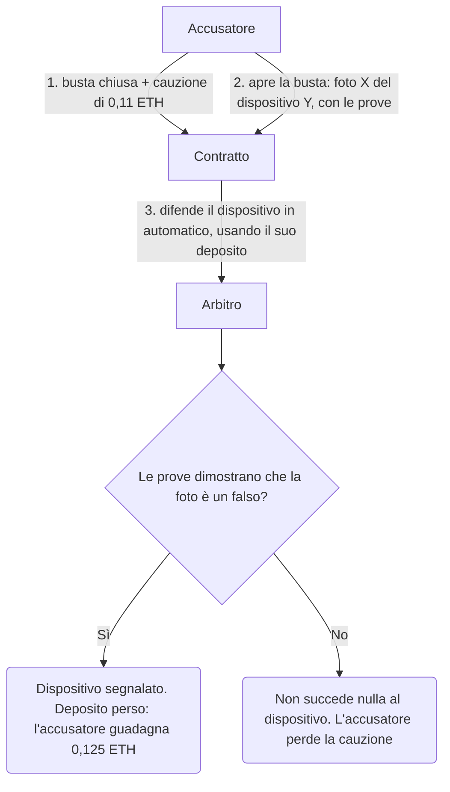

# 1. Come funziona Paprika

Questa è la versione finale del protocollo, spiegata senza dare nulla per scontato.
Per sapere che cosa è cambiato rispetto alla prima versione e perché, leggi
[2. Che cosa è cambiato](2-cosa-e-cambiato.md).

## In una frase

Chi vuole attestare foto registra il proprio dispositivo e lascia un **deposito**. Ogni foto viene
**firmata dal dispositivo** e registrata sulla blockchain. Se qualcuno dimostra che una foto
attestata è un falso, il dispositivo viene **segnalato** e il deposito viene tolto: una parte va a
chi ha fatto la contestazione.

Non ci sono produttori di dispositivi, comitati o amministratori. Chiunque può registrarsi,
attestare, verificare e contestare.

## Che cosa garantisce, e che cosa no

| | |
|---|---|
| **Garantisce** | Questa esatta foto è stata firmata da questo dispositivo registrato, in questo intervallo di tempo. Il dispositivo ha dei soldi in gioco. Tutto quello che è stato deciso su quel dispositivo si può leggere, con la data. Nessuno può cancellare nulla. |
| **Non garantisce** | Che la foto sia stata scattata da una fotocamera vera. Un dispositivo registrato può firmare anche un'immagine generata. Se lo fa, rischia il deposito: ma solo se qualcuno riesce a dimostrarlo. |

Paprika quindi non è un rilevatore di falsi. È un registro pubblico in cui chi attesta una foto
**ci mette la firma e i soldi**, e chiunque può chiamarlo a risponderne.

## Le parole che usiamo

| Parola | Significato |
|---|---|
| Dispositivo | La fotocamera o il telefono. Ha una sua chiave segreta con cui firma. |
| Proprietario | Il conto Ethereum che registra il dispositivo e ci mette il deposito. |
| Deposito | 0,25 ETH bloccati alla registrazione. Si perdono se il dispositivo viene segnalato. |
| Record | La riga salvata sulla blockchain: quale foto, quale dispositivo, quando. |
| Accusatore | Chiunque contesti una foto. Deve mettere una cauzione. |
| Cauzione | 0,11 ETH che l'accusatore blocca. Li perde se l'accusa è infondata. |
| Arbitro | Il servizio decentralizzato che decide se un'accusa è fondata. Non è una persona né un'azienda: è un voto pubblico (per esempio UMA). |
| Segnalazione | Il "ban" della prima versione. Il dispositivo non può più attestare. I suoi record passati restano visibili. |
| Relayer | Chiunque porti la firma del dispositivo sulla blockchain e paghi la commissione al suo posto. |

## Fase 1 — Registrazione

1. Il dispositivo crea la propria chiave.
2. Con quella chiave firma una frase che dice "appartengo al conto X". Serve a dimostrare che chi
   registra possiede davvero quel dispositivo.
3. Il proprietario invia chiave e firma al contratto, insieme al deposito.
4. Il contratto controlla la firma e registra il dispositivo.

Una chiave si può registrare **una volta sola**. Se viene segnalata, non rientra più.

## Fase 2 — Attestazione di una foto

1. Prima di scattare, il dispositivo legge il codice dell'ultimo blocco della blockchain. Quel
   codice non si può conoscere in anticipo.
2. Scatta la foto e ne calcola l'impronta (SHA-256).
3. Firma insieme l'impronta e il codice del blocco.
4. Chiunque può inviare quella firma al contratto. Il dispositivo non ha bisogno di avere ETH.
5. Il contratto controlla che il dispositivo sia attivo, che la firma sia sua e che il blocco sia
   uno degli ultimi 256. Poi salva il record.

**L'intervallo di tempo.** Dato che il codice del blocco non si poteva conoscere prima, la firma è
stata fatta *dopo* quel blocco. Dato che il record è in un certo blocco, è stata fatta *prima* di
quello. Il record dice quindi "firmata fra il blocco A e il blocco B".

Non c'è una tariffa e non c'è una cassa comune. Si paga solo la normale commissione della
blockchain.

## Verifica

Chiunque, senza chiedere il permesso a nessuno:

1. calcola l'impronta del file che ha in mano;
2. chiede al contratto se esiste un record per quell'impronta e quel dispositivo.

Il contratto risponde con: l'intervallo di tempo, lo stato del dispositivo (attivo, ritirato,
segnalato e da quando), quanto deposito è ancora in gioco, e se ci sono contestazioni aperte.

Se nel file è cambiato anche un solo pixel, l'impronta è diversa e il record non si trova.

## Fase 3 — Contestazione (il "ban" della prima versione)

Ci sono due modi per far segnalare un dispositivo.

### A. Accusa su una foto

È l'idea della prima versione: qualcuno sostiene che una foto attestata è un falso, e una
decisione decentralizzata stabilisce chi ha ragione.

1. **Busta chiusa.** L'accusatore invia un impegno che non rivela quale foto contesta, con la
   cauzione. Così il proprietario non può vedere l'accusa arrivare e muoversi prima.
2. **Apertura.** Poco dopo l'accusatore rivela foto, dispositivo e prove.
3. **Difesa automatica.** Il contratto contesta sempre l'accusa a nome del dispositivo, usando
   una parte del suo deposito. Il proprietario non deve sorvegliare nulla: un'accusa non passa mai
   "per silenzio".
4. **Decisione.** L'arbitro decide guardando le prove. Se le prove non bastano a dimostrare il
   falso, la risposta è no.

| Esito | Dispositivo | Accusatore | Proprietario |
|---|---|---|---|
| Accusa accolta | Segnalato; la foto è marcata come falso accertato | Riprende la cauzione e guadagna 0,125 ETH | Perde tutto il deposito (0,25 ETH) |
| Accusa respinta | Non cambia nulla | Perde la cauzione (0,11 ETH) | Guadagna 0,055 ETH |

Del denaro perso da chi ha torto, metà va a chi ha ragione e metà viene distrutta. Nessuno lo
amministra.

### B. Prova che la chiave è uscita dal dispositivo

La chiave di una fotocamera dovrebbe firmare solo foto. Se qualcuno riesce a far firmare a quella
chiave un messaggio speciale, di un tipo che nessuna fotocamera firmerebbe, vuol dire che ha la
chiave in mano: è stata copiata, rubata, prestata o venduta.

1. Chi ha la chiave firma il messaggio "questa chiave è fuori, pagate il conto Z".
2. Lo invia al contratto, che controlla la firma. Non serve nessun arbitro.
3. Il dispositivo viene segnalato. Il deposito viene diviso: 0,125 ETH a chi ha presentato la
   prova, 0,125 ETH distrutti.

Questa regola serve a due cose. Rende rischioso prestare o vendere un dispositivo registrato,
perché chi lo riceve può prendersi il deposito. E fa sì che chi trova una chiave rubata abbia
convenienza a farla bloccare.

### Che cosa succede dopo una segnalazione

- Il dispositivo non può più attestare.
- I record già salvati **restano**. Accanto a ciascuno si legge che il dispositivo è stato
  segnalato, in quale blocco e per quale motivo.
- Chi verifica decide quanto fidarsi: per esempio può considerare validi i record precedenti a
  un'accusa accolta su un'altra foto, e non fidarsi più di nulla se la chiave è risultata fuori
  dal dispositivo.

## Ritirare il deposito

Il proprietario può ritirarsi: il dispositivo smette subito di attestare e, dopo 30 giorni senza
contestazioni aperte, il deposito torna indietro. In quei 30 giorni chiunque può ancora contestare
le sue foto.

## I casi, uno per uno

Ogni riga è stata provata con un test: i numeri vengono dall'esecuzione, non da una stima.

| Caso | Che cosa succede |
|---|---|
| Registro un dispositivo, attesto una foto, la verifico | Il record viene salvato con il suo intervallo di tempo e chiunque lo ritrova |
| Cambio un pixel e verifico | Nessun record: l'impronta è diversa |
| Sono stato segnalato e rientro con una chiave nuova | Posso, ma mi serve un nuovo deposito di 0,25 ETH. La chiave vecchia è bruciata per sempre |
| Attesto un'immagine generata | Il contratto la accetta: non può sapere che cos'è. Se qualcuno lo dimostra, perdo 0,25 ETH |
| Qualcuno accusa una mia foto vera | Il contratto mi difende da solo. Accusa respinta: lui perde 0,11 ETH, io ne guadagno 0,055 |
| Mi accuso da solo con un secondo conto per incassare | Perdo in ogni caso: metà di quello che viene tolto è distrutto |
| So che mi stanno per scoprire e mi "auto-segnalo" con la prova B | Recupero metà deposito e ne perdo metà (0,125 ETH). Se l'accusa era già in busta chiusa, vince l'accusatore e io perdo tutto |
| Qualcuno copia dalla rete la mia attestazione prima che sia confermata | Non serve a nulla: il record resta legato alla mia firma |
| Qualcuno copia la prova o l'accusa di un altro | Non serve a nulla: entrambe nominano chi le ha fatte |
| Accusa su una foto che il dispositivo non ha mai attestato | Rifiutata: l'accusatore perde la cauzione |
| Mi rubano la chiave | Il ladro può far segnalare il dispositivo e prendersi 0,125 ETH del mio deposito |
| Mi ritiro e aspetto 30 giorni senza contestazioni | Riprendo il deposito. Chi verifica vede che il deposito non è più in gioco |
| Riempio di accuse finte i miei stessi record per bloccare gli altri | Costa 0,11 ETH a giro e ottiene solo un ritardo: dopo ogni decisione gli altri hanno tempo di contestare |
| Dispositivo segnalato con 100 record precedenti | Tutti e 100 restano leggibili, con la data della segnalazione accanto |

## I numeri

| Parametro | Valore |
|---|---|
| Deposito del proprietario | 0,25 ETH |
| Cauzione dell'accusatore | 0,11 ETH |
| Quota di deposito a chi fa segnalare | 50% (il resto è distrutto) |
| Attesa per ritirare il deposito | 30 giorni |
| Tempo fra busta chiusa e apertura | da 1 a 50 blocchi |
| Quanto può essere vecchio il blocco letto prima dello scatto | 256 blocchi |

Questi valori sono quelli del prototipo. Su una rete vera vanno scelti in base a quanto vale ciò
che si vuole proteggere: vedi [3. Limiti e dipendenze](3-limiti-e-dipendenze.md).

## Dov'è il codice

Il contratto è [`contract/contracts/Paprika.sol`](../contract/contracts/Paprika.sol), con i suoi
test in [`contract/test/`](../contract/test/). Nella demo gira su una blockchain Ethereum locale,
e l'arbitro è simulato: nessun voto vero ha luogo.
