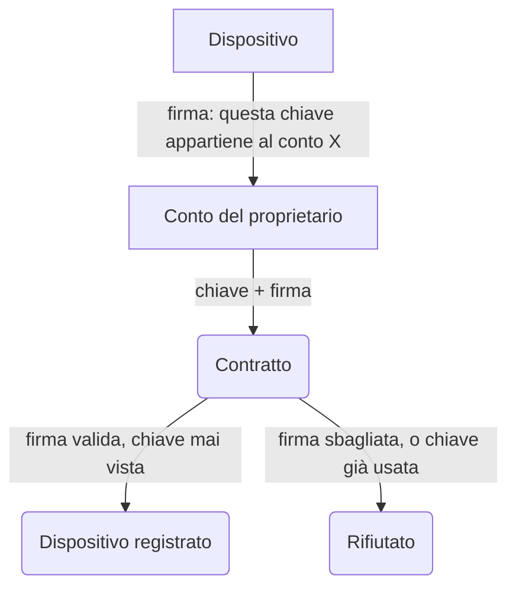
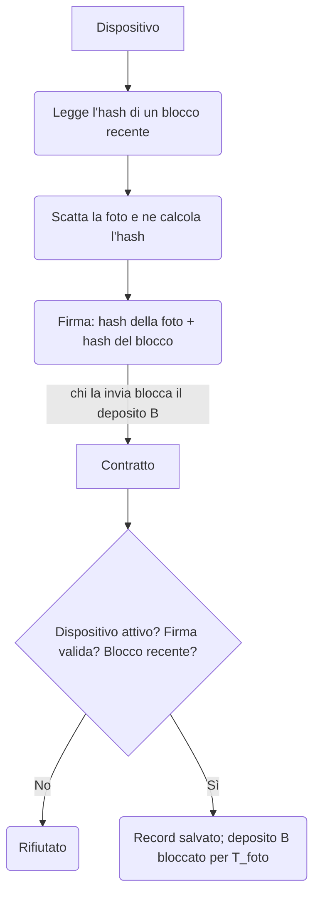
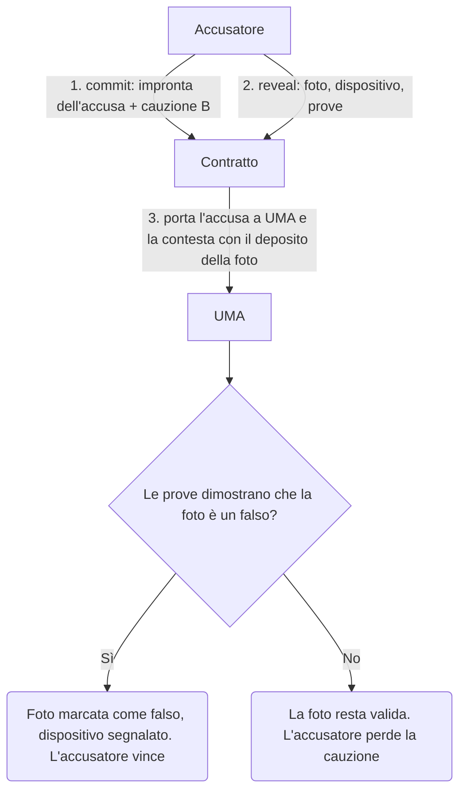

# 1. Come funziona Paprika

Questa è la versione definitiva del protocollo. Per sapere che cosa è cambiato rispetto alla
prima versione e perché, leggi [2. Che cosa è cambiato](2-cosa-e-cambiato.md).

## In una frase

Ogni foto attestata è **firmata dal dispositivo** e ha un **deposito** in gioco. Chiunque può
accusarla di essere un falso mettendo una cauzione uguale. Decide **UMA**. Chi ha torto perde i
soldi. Se nessuno la accusa entro un certo tempo, il deposito torna indietro.

Non ci sono produttori di dispositivi, comitati o amministratori.

## Che cosa garantisce, e che cosa no

| | |
|---|---|
| **Garantisce** | Questa esatta foto è stata firmata da questo dispositivo registrato, in questo intervallo di tempo. Chi l'ha attestata ha messo dei soldi in gioco. Tutto ciò che è stato deciso su quella foto e su quel dispositivo si può leggere, con la data. Nessuno può cancellare nulla. |
| **Non garantisce** | Che la foto sia stata scattata da una fotocamera vera. Un dispositivo registrato può firmare anche un'immagine generata. Se lo fa rischia il deposito, ma solo se qualcuno riesce a dimostrarlo entro il tempo previsto. |

## I parametri

Nel contratto non ci sono valori fissi. Si scelgono quando il contratto viene pubblicato, e dopo
non li può cambiare nessuno, perché il contratto non ha un amministratore.

| Simbolo | Che cos'è |
|---|---|
| `B` | La somma che mette chi attesta una foto (deposito) e, uguale, chi la accusa (cauzione). UMA richiede che le due somme siano uguali |
| `T_foto` | Per quanto tempo una foto può essere accusata dopo l'attestazione |
| `T_reveal` | Quanto tempo ha chi accusa per completare l'accusa dopo averla depositata |
| `f` | La parte della somma di chi perde che UMA trattiene come commissione. La fissa UMA, non noi (oggi è la metà) |

Le somme sono in un token ERC-20 accettato da UMA, non in ETH: è così che funziona UMA.

## Le parole che usiamo

| Parola | Significato |
|---|---|
| Dispositivo | La fotocamera o il telefono. Ha una chiave segreta con cui firma |
| Record | La riga salvata sulla blockchain: quale foto, quale dispositivo, quando |
| Hash della foto | L'impronta SHA-256 del file: cambia se cambia anche un solo pixel |
| Hash del blocco | La sequenza di 32 byte che la blockchain calcola per ogni blocco. Non si può prevedere prima che il blocco esista |
| Accusatore | Chiunque contesti una foto |
| UMA | Il servizio decentralizzato che decide le accuse (Optimistic Oracle V3). Decide un voto pubblico di chi possiede il token UMA |
| Segnalazione | Il "ban" della prima versione. Il dispositivo non può più attestare; i suoi record restano |
| Commit–reveal | Fare un'accusa in due passaggi: prima se ne deposita solo l'impronta, poi la si rivela |

## Fase 1 — Registrazione

1. Il dispositivo crea la propria chiave.
2. Con quella chiave firma un messaggio che contiene l'indirizzo del proprietario. Dimostra che
   chi registra possiede davvero quella chiave.
3. Il contratto controlla la firma e registra il dispositivo.

Registrarsi è gratuito. Una chiave si registra una volta sola: se viene segnalata non rientra più.

## Fase 2 — Attestazione di una foto

1. Prima di scattare, il dispositivo legge l'hash dell'ultimo blocco.
2. Scatta la foto e ne calcola l'hash.
3. Firma insieme l'hash della foto e l'hash del blocco.
4. Chi invia la firma al contratto blocca il deposito `B`. Può essere il proprietario o chiunque
   altro per lui.
5. Il contratto controlla che il dispositivo sia attivo, che la firma sia sua e che il blocco sia
   uno degli ultimi 256. Poi salva il record.

**L'intervallo di tempo.** L'hash del blocco non si poteva conoscere prima, quindi la firma è
stata fatta *dopo* quel blocco. Il record è in un blocco successivo, quindi è stata fatta *prima*
di quello.

**Perché il deposito.** Senza, riempire il registro di attestazioni costerebbe solo la commissione
della blockchain. Con il deposito, chi attesta N foto deve tenere bloccato N × `B` per il tempo
`T_foto`.

## Fase 2 bis — Riprendere il deposito

Se nessuno accusa la foto entro `T_foto`, chi ha messo il deposito lo riprende per intero. Il
record resta per sempre: da quel momento chi verifica vede che la foto ha superato il periodo di
contestazione.

Per sicurezza il deposito si può riprendere solo dopo `T_foto + T_reveal`, così un'accusa
depositata all'ultimo momento fa ancora in tempo a essere rivelata.

## Fase 3 — Accusa (il "ban" della prima versione)

### I due passaggi dell'accusa (commit–reveal)

1. **Commit.** L'accusatore invia solo un'impronta, calcolata su: il proprio indirizzo, la foto,
   il dispositivo, le prove e un numero segreto. Insieme blocca la cauzione `B`. Dall'impronta
   nessuno può capire quale foto è sotto accusa.
2. **Reveal.** Almeno un blocco dopo, ed entro `T_reveal`, invia i dati veri. Il contratto
   ricalcola l'impronta e controlla che coincida.

**A che cosa serve.** Su una blockchain una transazione è visibile a tutti prima di essere
confermata. Se l'accusa si facesse in un passaggio solo, chiunque potrebbe copiarla e inviarla a
proprio nome per prendersi il premio. Anche chi ha attestato il falso potrebbe farlo, per limitare
la perdita. Con i due passaggi nessuno sa quale foto è accusata finché non è tardi per passare
davanti.

Chi fa il commit e poi non fa il reveal in tempo perde la cauzione.

### Che cosa succede quando l'accusa arriva a UMA

UMA vota solo sulle affermazioni che qualcuno contesta. Per questo il contratto fa due cose nello
stesso momento: presenta a UMA l'accusa con la cauzione dell'accusatore, e la contesta usando il
deposito della foto. Così ogni accusa arriva a un voto, e nessuna foto viene condannata solo
perché chi l'ha attestata non stava guardando.

UMA risponde alla domanda: *le prove allegate dimostrano che questa foto non è una vera cattura?*
Per le regole di UMA la risposta è sì solo se la cosa si può verificare pubblicamente. Se le prove
non bastano, la risposta è no.

| Esito | Foto e dispositivo | Accusatore | Chi aveva messo il deposito |
|---|---|---|---|
| **Falso dimostrato** | La foto è marcata come falso. Il dispositivo è segnalato e non attesta più | Riprende `B` e riceve `B − f×B` | Perde `B` |
| **Non dimostrato** | Non cambia nulla. La foto resta accusabile per il tempo che le rimaneva | Perde `B` | Tiene il deposito e riceve `B − f×B` |

In entrambi i casi UMA trattiene `f×B` dalla somma di chi perde.

Su una foto può esserci una sola accusa aperta alla volta. Il tempo passato sotto accusa non
viene tolto da `T_foto`: accusarsi da soli per far scadere il tempo non funziona, e ogni giro
costa `f×B`.

### Revoca della chiave

Chi ha in mano la chiave di un dispositivo può farlo segnalare con una firma, senza UMA e senza
soldi. Serve al proprietario a cui hanno rubato o copiato la chiave. Le foto già attestate e i
loro depositi non vengono toccati.

### Dopo una segnalazione

- Il dispositivo non può più attestare.
- I record già salvati restano, ciascuno con il proprio deposito e il proprio periodo di
  contestazione.
- Accanto a ogni record si legge che il dispositivo è stato segnalato, in quale blocco e perché.

## Verifica

Chiunque, senza chiedere il permesso a nessuno, calcola l'hash del file e chiede al contratto il
record per quell'hash e quel dispositivo. La risposta dice:

- l'intervallo di tempo in cui la foto è stata firmata;
- lo stato della foto: attestata con deposito ancora bloccato, sotto accusa, periodo di
  contestazione superato, oppure falso dimostrato;
- lo stato del dispositivo: attivo, oppure segnalato, da quale blocco e perché.

Se nel file è cambiato anche un solo pixel, l'hash è diverso e il record non si trova.

## I casi, uno per uno

| Caso | Che cosa succede |
|---|---|
| Attesto una foto e nessuno la accusa | Dopo `T_foto + T_reveal` riprendo `B`. Il record resta |
| Cambio un pixel e verifico | Nessun record |
| Attesto un falso e qualcuno lo dimostra | Perdo `B`. La foto è marcata, il dispositivo segnalato. L'accusatore guadagna `B − f×B` |
| Attesto un falso e nessuno lo accusa in tempo | Riprendo `B`. Il falso resta attestato |
| Qualcuno accusa una mia foto vera | UMA respinge. Lui perde `B`, io guadagno `B − f×B` |
| Mi accuso da solo con un secondo conto | Perdo sempre `f×B`: la parte che UMA trattiene |
| Sono stato segnalato e rientro con una chiave nuova | Posso, gratis. Ho perso il deposito di quella foto e la storia del dispositivo |
| Qualcuno copia la mia attestazione prima che sia confermata | Il record resta legato alla firma del mio dispositivo. Il deposito lo ha messo lui, e lo riavrà lui |
| Qualcuno copia il commit o il reveal di un altro | Non serve: l'impronta contiene l'indirizzo di chi accusa |
| Accusa su una foto mai attestata, o fuori tempo | Rifiutata. Se l'accusatore non può più rivelare, perde la cauzione |
| Seconda accusa mentre ce n'è una aperta sulla stessa foto | Deve aspettare l'esito della prima |
| Mi rubano la chiave | Revoco la chiave: il dispositivo è segnalato e non attesta più |
| Dispositivo segnalato con tanti record precedenti | Restano tutti leggibili, con la data della segnalazione accanto |

I numeri misurati per ciascun caso sono in
[`contract/output/cases.md`](../contract/output/cases.md).

## Che cosa gira nella demo

Tutto gira su una blockchain Ethereum locale.

- **Vero:** il contratto di Paprika; i contratti di UMA (Optimistic Oracle V3), pubblicati in
  locale così come sono; le firme; i depositi e i pagamenti.
- **Simulato:** il dispositivo (la chiave è creata dal programma); il voto dei possessori del
  token UMA, sostituito dallo strumento che UMA stessa usa sulle reti di prova: l'esito lo
  inseriamo noi, per mostrare entrambi i casi.

## Dov'è il codice

Il contratto è [`contract/contracts/Paprika.sol`](../contract/contracts/Paprika.sol), con i suoi
test in [`contract/test/`](../contract/test/).
