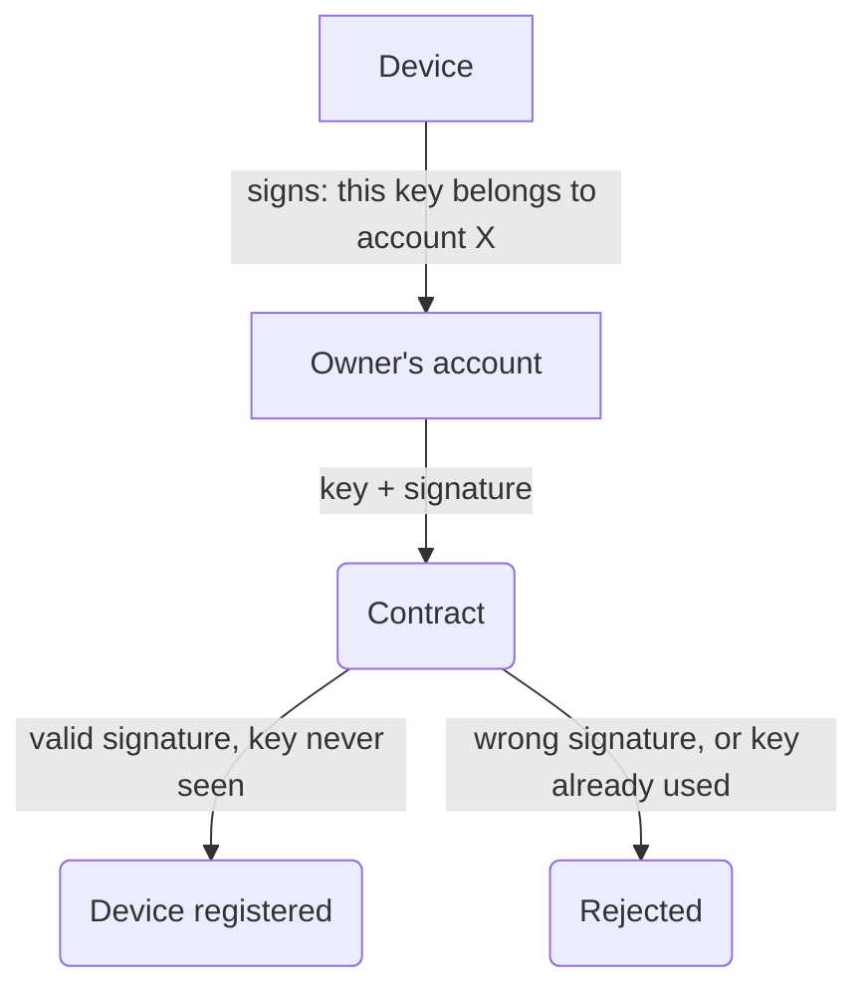
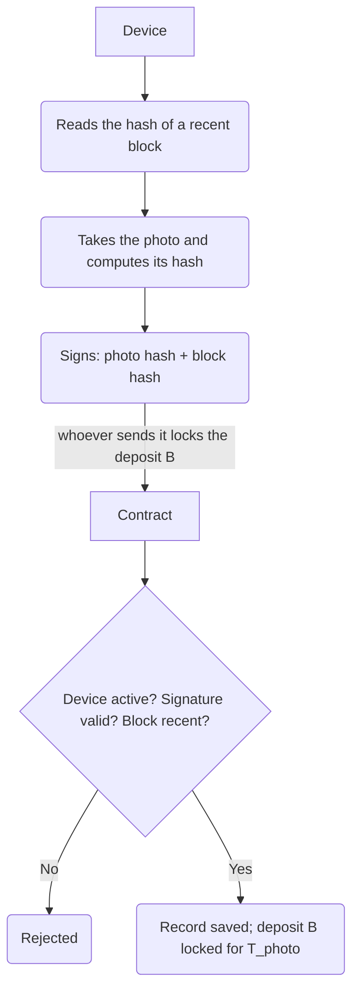
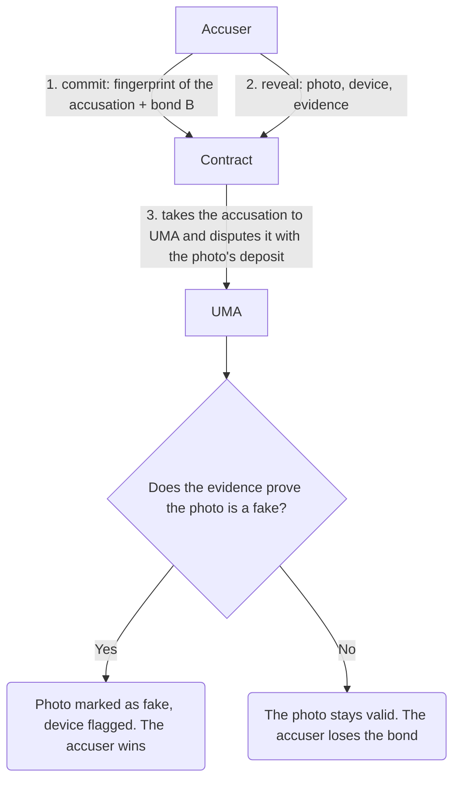

# 1. How Paprika works

This is the final version of the protocol. To find out what changed from the first version, and
why, read [2. What changed](2-what-changed.md).

## In one sentence

Every attested photo is **signed by the device** and has a **deposit** at stake. Anyone can
accuse it of being a fake by putting up an equal bond. **UMA** decides. Whoever is wrong loses
the money. If nobody accuses it within a set time, the deposit goes back.

There are no device makers, committees or administrators.

## What it guarantees, and what it does not

| | |
|---|---|
| **Guarantees** | This exact photo was signed by this registered device, in this time window. Whoever attested it put money at stake. Everything that was decided about that photo and that device can be read, with the date. Nobody can delete anything. |
| **Does not guarantee** | That the photo was taken by a real camera. A registered device can also sign a generated image. If it does, it risks the deposit, but only if someone manages to prove it within the set time. |

## The parameters

There are no fixed values in the contract. They are chosen when the contract is published, and
after that nobody can change them, because the contract has no administrator.

| Symbol | What it is |
|---|---|
| `B` | The amount put up by whoever attests a photo (deposit) and, the same amount, by whoever accuses it (bond). UMA requires the two amounts to be equal |
| `T_photo` | How long a photo can be accused after it is attested |
| `T_reveal` | How much time the accuser has to complete the accusation after filing it |
| `f` | The share of the loser's amount that UMA keeps as a fee. UMA sets it, not us (today it is half) |

The amounts are in an ERC-20 token accepted by UMA, not in ETH: this is how UMA works.

## The words we use

| Word | Meaning |
|---|---|
| Device | The camera or the phone. It has a secret key that it signs with |
| Record | The row saved on the blockchain: which photo, which device, when |
| Photo hash | The SHA-256 fingerprint of the file: it changes if even a single pixel changes |
| Block hash | The 32-byte sequence that the blockchain computes for each block. It cannot be predicted before the block exists |
| Accuser | Anyone who challenges a photo |
| UMA | The decentralized service that decides accusations (Optimistic Oracle V3). A public vote by the holders of the UMA token decides |
| Flag | The "ban" of the first version. The device can no longer attest; its records stay |
| Commit-reveal | Making an accusation in two steps: first you file only its fingerprint, then you reveal it |

## Phase 1 — Registration

1. The device creates its own key.
2. With that key it signs a message that contains the owner's address. This proves that whoever
   registers really holds that key.
3. The contract checks the signature and registers the device.

Registering is free. A key can be registered only once: if it is flagged, it cannot come back.

## Phase 2 — Attesting a photo

1. Before taking the photo, the device reads the hash of the latest block.
2. It takes the photo and computes its hash.
3. It signs the photo hash and the block hash together.
4. Whoever sends the signature to the contract locks the deposit `B`. This can be the owner or
   anyone else on the owner's behalf.
5. The contract checks that the device is active, that the signature is the device's, and that
   the block is one of the last 256. Then it saves the record.

**The time window.** The block hash could not be known in advance, so the signature was made
*after* that block. The record is in a later block, so the signature was made *before* that one.

**Why the deposit.** Without it, filling the registry with attestations would cost only the
blockchain fee. With the deposit, whoever attests N photos must keep N × `B` locked for the time
`T_photo`.

## Phase 2b — Taking the deposit back

If nobody accuses the photo within `T_photo`, the depositor takes the whole deposit back. The
record stays forever: from then on, whoever checks sees that the photo has passed the challenge
period.

To be safe, the deposit can be taken back only after `T_photo + T_reveal`, so that an accusation
filed at the last moment still has time to be revealed.

## Phase 3 — Accusation (the "ban" of the first version)

### The two steps of the accusation (commit-reveal)

1. **Commit.** The accuser sends only a fingerprint, computed from: their own address, the photo,
   the device, the evidence and a secret number. At the same time they lock the bond `B`. From the
   fingerprint nobody can tell which photo is being accused.
2. **Reveal.** At least one block later, and within `T_reveal`, they send the real data. The
   contract recomputes the fingerprint and checks that it matches.

**What it is for.** On a blockchain, a transaction is visible to everyone before it is confirmed.
If the accusation were made in a single step, anyone could copy it and send it in their own name
to take the reward. Even whoever attested the fake could do this, to limit the loss. With the two
steps, nobody knows which photo is accused until it is too late to jump ahead.

Whoever makes the commit and then does not make the reveal in time loses the bond.

### What happens when the accusation reaches UMA

UMA votes only on claims that someone disputes. That is why the contract does two things at the
same moment: it submits the accusation to UMA with the accuser's bond, and it disputes it using
the photo's deposit. This way every accusation reaches a vote, and no photo is condemned just
because whoever attested it was not watching.

UMA answers the question: *does the attached evidence prove that this photo is not a real
capture?* Under UMA's rules the answer is yes only if the matter can be checked publicly. If the
evidence is not enough, the answer is no.

| Outcome | Photo and device | Accuser | Depositor |
|---|---|---|---|
| **Proven fake** | The photo is marked as fake. The device is flagged and no longer attests | Gets `B` back and receives `B − f×B` | Loses `B` |
| **Not proven** | Nothing changes. The photo can still be accused for the time it had left | Loses `B` | Keeps the deposit and receives `B − f×B` |

In both cases UMA keeps `f×B` from the loser's amount.

A photo can have only one open accusation at a time. The time spent under accusation is not
subtracted from `T_photo`: accusing yourself to run out the clock does not work, and each round
costs `f×B`.

### Key revocation

Whoever holds a device's key can have the device flagged with a signature, without UMA and without
money. This is for an owner whose key was stolen or copied. Photos already attested and their
deposits are not touched.

### After a flag

- The device can no longer attest.
- The records already saved stay, each with its own deposit and its own challenge period.
- Next to each record you can read that the device was flagged, in which block and why.

## Verification

Anyone, without asking anyone's permission, computes the hash of the file and asks the contract
for the record for that hash and that device. The answer tells:

- the time window in which the photo was signed;
- the state of the photo: attested with the deposit still locked, under accusation, challenge
  period passed, or proven fake;
- the state of the device: active, or flagged, from which block and why.

If even a single pixel in the file changed, the hash is different and the record is not found.

## The cases, one by one

| Case | What happens |
|---|---|
| I attest a photo and nobody accuses it | After `T_photo + T_reveal` I take `B` back. The record stays |
| I change one pixel and check | No record |
| I attest a fake and someone proves it | I lose `B`. The photo is marked, the device flagged. The accuser earns `B − f×B` |
| I attest a fake and nobody accuses it in time | I take `B` back. The fake stays attested |
| Someone accuses a real photo of mine | UMA rejects it. They lose `B`, I earn `B − f×B` |
| I accuse myself with a second account | I always lose `f×B`: the share UMA keeps |
| I was flagged and come back with a new key | I can, for free. I lost the deposit on that photo and the device's history |
| Someone copies my attestation before it is confirmed | The record stays tied to my device's signature. They put up the deposit, and they will get it back |
| Someone copies another person's commit or reveal | It does not help: the fingerprint contains the accuser's address |
| Accusation on a photo never attested, or out of time | Rejected. If the accuser can no longer reveal, they lose the bond |
| Second accusation while one is open on the same photo | It must wait for the outcome of the first |
| My key is stolen | I revoke the key: the device is flagged and no longer attests |
| Flagged device with many earlier records | They all stay readable, with the date of the flag next to them |

The numbers measured for each case are in
[`contract/output/cases.md`](../contract/output/cases.md).

## What runs in the demo

Everything runs on a local Ethereum blockchain.

- **Real:** the Paprika contract; the UMA contracts (Optimistic Oracle V3), published locally just
  as they are; the signatures; the deposits and the payments.
- **Simulated:** the device (the key is created by the program); the vote of the UMA token
  holders, replaced by the tool that UMA itself uses on test networks: we enter the outcome
  ourselves, to show both cases.

## Where the code is

The contract is [`contract/contracts/Paprika.sol`](../contract/contracts/Paprika.sol), with its
tests in [`contract/test/`](../contract/test/).
