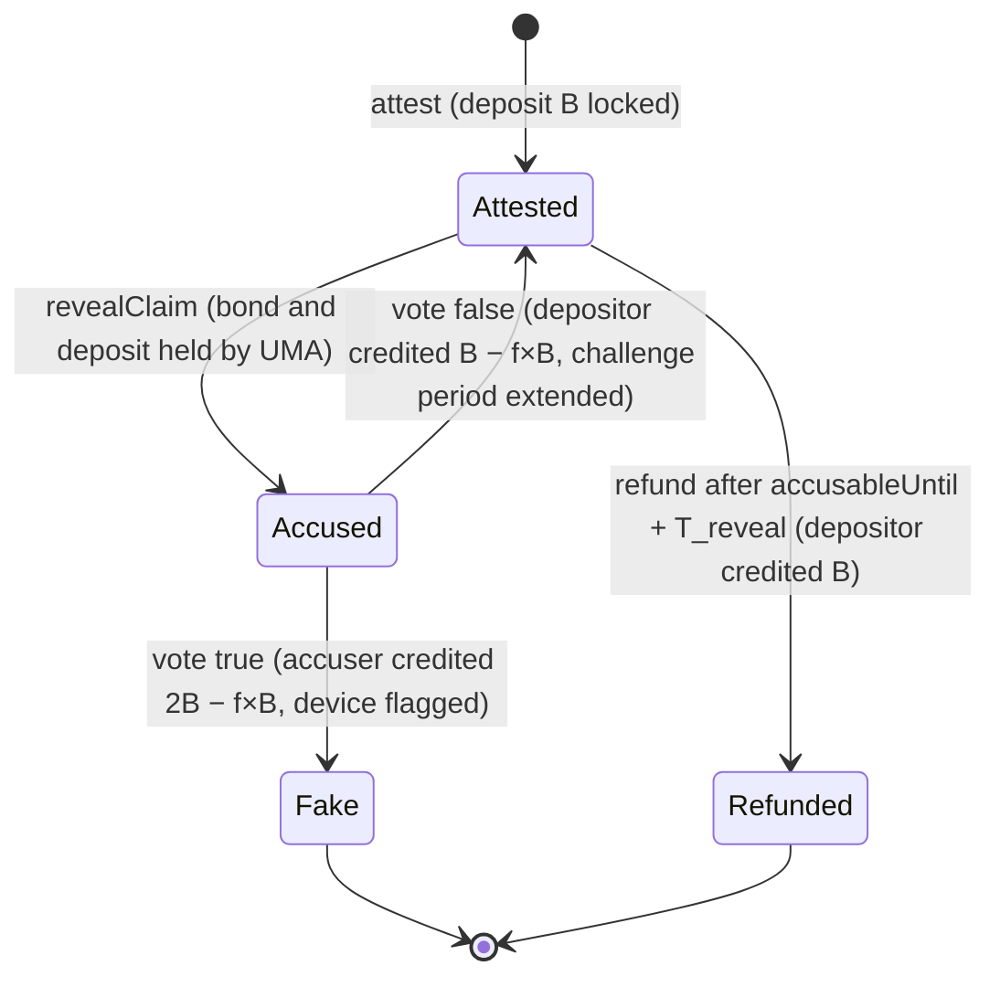
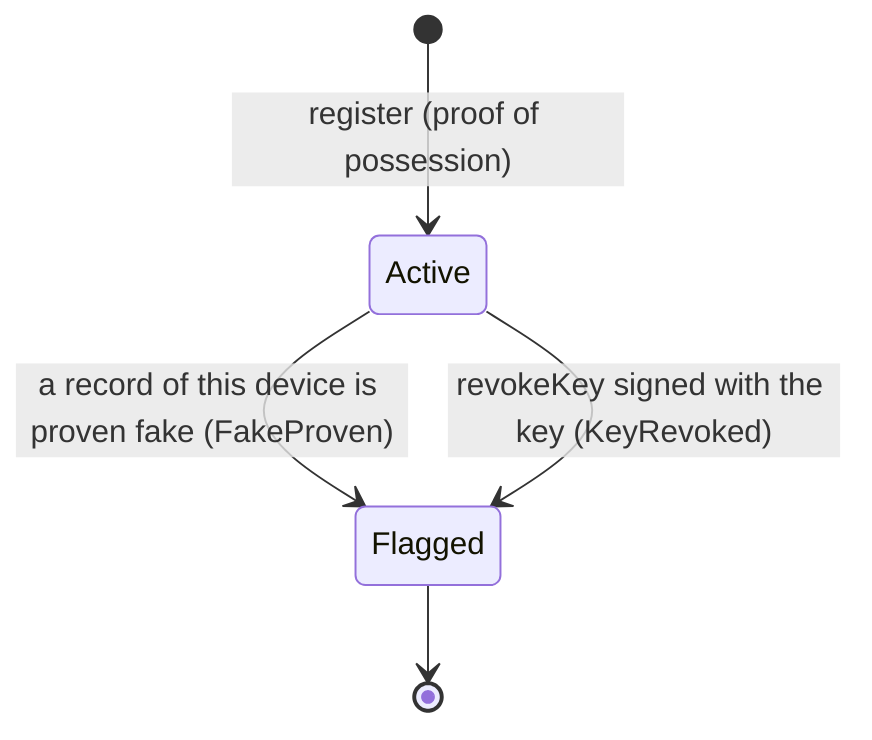
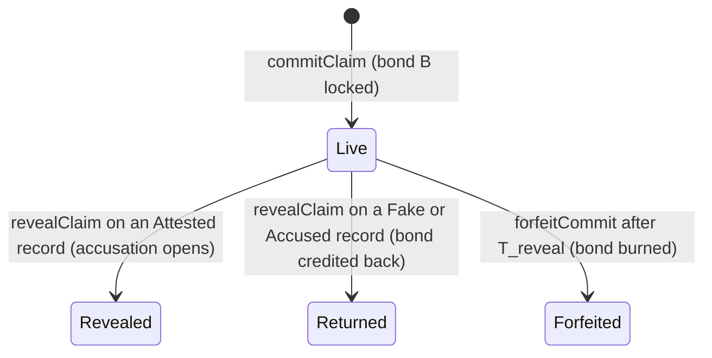

# Paprika: protocol specification

## Summary

A registered device key signs each photo hash together with a recent block hash; the record carries a refundable
deposit; anyone can accuse the record by staking an equal bond, and UMA's Optimistic Oracle V3 decides.

The contract is [`contract/contracts/Paprika.sol`](../contract/contracts/Paprika.sol). This document describes it.
If this document and the contract disagree, the contract is correct.
The reasons for each rule are in [design-rationale.md](design-rationale.md).

## What a record proves

A **record** is the entry that the contract stores for one photo hash and one device key. It proves:

1. The holder of the private key `keyId` signed this exact **photo hash** (the SHA-256 of the file).
2. The signature was made after block `a` (the anchor block) and before block `r` (the record block).
3. The signature is bound to this contract and this chain. It cannot be replayed elsewhere.
4. A **depositor** locked a deposit `B` on the record.
5. The current state of the record and of its device, and the block of every change, are public.

## Terms

| Term | Meaning |
|---|---|
| Device | A registered P-256 (secp256r1) public key `(x, y)`. Its identifier is `keyId = sha256(x ‖ y)` |
| Photo hash | The SHA-256 of the photo file. One changed bit gives a different photo hash |
| Block hash | The 32-byte hash of an Ethereum block. Nobody can predict it before the block exists |
| Anchor block `a` | The block whose hash the device signs. It must be one of the last 256 blocks when the record is made |
| Record block `r` | The block that contains the record |
| Record | The entry for one pair (photo hash, `keyId`) |
| Depositor | The account that sends the record and pays the deposit |
| Deposit | The amount `B` that the depositor locks on one record |
| Accuser | The account that accuses a record |
| Bond | The amount `B` that the accuser locks on one accusation |
| Accusation | A claim that a record is not a genuine capture by its device, sent to UMA |
| Commitment | `keccak256(abi.encode(accuser, photoHash, keyId, evidenceHash, salt))`. It hides the target of an accusation |
| Evidence | The file or text that proves the accusation. The accuser publishes it at `<evidenceBaseURI>/<evidence SHA-256 in hex>` |
| Evidence hash | The SHA-256 of the evidence. It names the evidence and lets anyone check it |
| Challenge period | The time during which a commitment against a record is valid: until `accusableUntil` |
| Flag | A device status. A flagged device cannot make new records. Its records stay |
| Credit | An amount that the contract owes to an account. The account withdraws it with `withdrawCredit` |
| UMA | The UMA protocol. Its Optimistic Oracle V3 (OOv3) receives the accusation. Its token-holder vote decides it |

All amounts are in one token: WETH (wrapped ETH, an ERC-20 token). An ERC-20 token is the standard fungible token
interface on Ethereum. WETH holds ETH one to one. UMA must accept the token as bond currency.
The token is a deployment parameter; this document and the demo use WETH.

## Actors

| Actor | What it does | What it needs |
|---|---|---|
| Device | Holds a P-256 private key. Signs registration, captures and revocation | Read access to a recent block hash |
| Registrant | Sends the registration of a key. Any account | Only gas |
| Depositor | Sends a signed capture and locks `B`. Often a relayer, not the device | `B` in WETH, approved to the contract |
| Accuser | Publishes the evidence, then commits and reveals an accusation | `B` in WETH, approved to the contract |
| UMA | OOv3 holds both stakes. The UMA token holders vote on the accusation | Nothing from Paprika beyond the claim |
| Verifier | Hashes a file and reads the contract. Any party | Read access to any node of the chain |

There is no owner, no administrator and no manufacturer. Every function is open to every account.

## Parameters

The deployer sets the parameters once, in the constructor. No function changes them.

| Symbol | Name in the contract | Meaning |
|---|---|---|
| `B` | `BOND` | The deposit per record and the bond per accusation. The two amounts are equal |
| `T_photo` | `PHOTO_WINDOW` | Seconds from the record to the end of its challenge period. Time under accusation is added to it |
| `T_reveal` | `REVEAL_WINDOW` | Seconds after a commitment during which its accuser can reveal it |
| `f` | `burnedBondPercentage / 1e18`, read from UMA | The share of the loser's stake that UMA keeps as its fee. UMA sets it. Paprika reads it at each settlement |
| - | `oo`, `currency` | The OOv3 address and the token (WETH) |
| - | `LIVENESS` | Passed to UMA. It has no effect: Paprika disputes every accusation at once |
| - | `identifier` | UMA's default identifier, read at deployment |
| - | `evidenceBaseURI` | The base URL where evidence is published. The claim links to `<evidenceBaseURI>/<evidence SHA-256 in hex>` |

The constructor rejects the deployment unless `B > 0`, `B` is at least UMA's minimum bond for the token,
`T_photo`, `T_reveal` and `LIVENESS` are not zero, and `evidenceBaseURI` is not empty.

## Signed messages

The device signs with ECDSA on P-256 over the SHA-256 of a message. The message is the concatenation
of the fields below, in this order (Solidity `abi.encodePacked`).

| Message | Fields, in order | Length |
|---|---|---|
| Registration | `"PAPRIKA/REGISTER"`, `chainid` (32 bytes), contract address (20), `keyId` (32), sender address (20) | 120 bytes |
| Capture | `"PAPRIKA/CAPTURE"`, `chainid` (32), contract address (20), `keyId` (32), photo hash (32), block hash of `a` (32) | 163 bytes |
| Revocation | `"PAPRIKA/REVOKE"`, `chainid` (32), contract address (20), `keyId` (32), sender address (20) | 118 bytes |

Rules for every signature:

- It is 64 bytes: `r ‖ s`.
- `s` must be at most half the group order (low-s). So each signature has one valid form.
- The chain's P-256 precompile at address `0x100` (EIP-7951) checks it.
  If the precompile is missing, every signature fails.

The accusation uses two more messages. Neither is a device signature.

| Message | Content |
|---|---|
| Commitment | `keccak256(abi.encode(accuser, photoHash, keyId, evidenceHash, salt))`, with five 32-byte words |
| Claim sent to UMA | A readable question with the chain id, the contract address, the photo hash, `keyId`, the evidence SHA-256 and the evidence URL. The contract builds it at the reveal. The text is in step 6 |

## Steps

### 1. Register a device

- **Who calls:** any account, with `register(x, y, popSig)`.
- **Checks:** the key was never registered. `popSig` is the key's signature over the registration message.
  The registration message names the sender, so `popSig` is a proof of possession for this sender only.
- **Changes:** the device becomes Active. The sender is stored as `owner`. `owner` gives no right.
- **Money:** none.

A key registers once. A flagged key cannot register again.

### 2. Attest a photo

- **Device:** reads the hash of a recent block `a`. Computes the photo hash. Signs the capture message.
- **Who calls:** any account, with `attest(photoHash, a, keyId, sig)`. This account becomes the depositor.
- **Checks:**
  1. The device is Active.
  2. `blockhash(a)` is not zero. So `a` is one of the 256 blocks before the current block.
  3. No record exists for (photo hash, `keyId`).
  4. `sig` is the key's signature over the capture message.
- **Changes:** a new record in state Attested, with the depositor, `a`, `r` (the current block) and
  `accusableUntil = now + T_photo`. The key is appended to `attestersOf(photoHash)`.
- **Money:** the contract pulls `B` from the depositor (`transferFrom`; the depositor approves it before).

Several devices can attest the same photo hash. Each record is independent.

### 3. Refund the deposit

- **Who calls:** any account, with `refund(photoHash, keyId)`.
- **Checks:** the record is Attested, and `now > accusableUntil + T_reveal`.
  This is after the last moment at which a valid commitment can be revealed.
- **Changes:** the record becomes Refunded. The record stays.
- **Money:** credit `B` to the depositor.

### 4. Accuse, step 1: publish the evidence

- **Who acts:** the accuser, off the chain.
- **What happens:** the accuser uploads the evidence. The evidence host stores it under its SHA-256 and serves it at
  `<evidenceBaseURI>/<evidence SHA-256 in hex>`. The name is the hash, so anyone can check that the file is unchanged.
- **Money:** none.

### 5. Accuse, step 2: commit

- **Who calls:** any account, with `commitClaim(commitment)`. This account is the accuser.
- **Checks:** this commitment value was never used.
- **Changes:** stores the accuser, the time and the block of the commitment.
- **Money:** the contract pulls the bond `B` from the accuser.

Nobody can read the target photo from the commitment.

### 6. Accuse, step 3: reveal

- **Who calls:** the accuser, with `revealClaim(photoHash, keyId, evidenceHash, salt)`.
- **Checks:**
  1. The commitment computed from the sender and the arguments exists and is live.
  2. The current block is later than the commitment block.
  3. `now ≤ commitment time + T_reveal`.
  4. The record exists, and it is not Refunded.
  5. The commitment block is at or after the record block `r`, and the commitment time is at or before
     `accusableUntil`.
- **Changes, if the record is Fake or Accused:** the commitment is closed. No accusation opens.
  The open accusation, if any, does not change. The accuser can commit again later.
  **Money:** credit `B` back to the accuser.
- **Changes, if the record is Attested:** the record becomes Accused. The contract then:
  1. asserts at OOv3 the claim below, with the accuser's bond `B`;
  2. disputes the same assertion at once, with the record's deposit `B`.
  The dispute sends the accusation to the UMA token-holder vote.
  **Money:** OOv3 pulls `2 × B` from the contract and holds it.

The claim sent to UMA is this text. Hashes and the address are lowercase hex; the chain id is decimal.

> Paprika accusation. Question: is the photo with SHA-256 0x`photoHash`, attested with the device key id 0x`keyId`
> on chain id `chainid` by the Paprika contract 0x`address`, NOT a genuine capture by that device (for example
> generated, edited, or a copy of an earlier image)? Answer true only if the evidence publicly proves it; otherwise
> answer false. Evidence SHA-256: 0x`evidenceHash`. Evidence URL: `evidenceBaseURI`/`evidenceHash` (the file at that
> URL must hash to the SHA-256 above).

Under UMA's rules for this identifier ([UMIP-170](https://github.com/UMAprotocol/UMIPs/blob/master/UMIPs/umip-170.md)),
voters answer true only if the claim is "true and publicly verifiable". So the accusation carries the burden of proof.

A commitment that is not revealed within `T_reveal` can be forfeited by any account with
`forfeitCommit(commitment)`. Its bond `B` goes to the burn address `0x…dEaD`.

### 7. UMA decision

UMA's vote decides. Any account then calls `settleAssertion` at OOv3. OOv3 pays the contract
`2 × B − f × B` and sends `f × B` to UMA's Store. Then OOv3 calls `assertionResolvedCallback` on the contract.

- **Checks:** the caller is OOv3. The assertion is an open accusation of this contract; otherwise nothing happens.
- **Fake proven (vote true):**
  - The record becomes Fake. This state is final.
  - If the device is Active, it becomes Flagged with reason FakeProven, at the current block.
  - **Money:** credit `2 × B − f × B` to the accuser.
- **Accusation rejected (vote false):**
  - The record returns to Attested. The deposit `B` is held again by the contract.
  - `accusableUntil` grows by the time the record spent Accused.
  - **Money:** credit `B − f × B` to the depositor.

### 8. Revoke a key

- **Who calls:** any account that holds the key, with `revokeKey(keyId, sig)`.
- **Checks:** the device is Active. `sig` is the key's signature over the revocation message, which names the sender.
- **Changes:** the device becomes Flagged with reason KeyRevoked, at the current block. Records do not change.
- **Money:** none.

### 9. Withdraw a credit

- **Who calls:** any account with a credit, with `withdrawCredit()`.
- **Money:** the contract transfers the whole credit of the sender to the sender.

### 10. Verify a file

Any party can verify. No transaction and no permission are needed.

1. Compute the SHA-256 of the file.
2. Call `attestersOf(photoHash)`. It returns the key identifiers that attested this hash, oldest first.
3. For each key, call `verify(photoHash, keyId)`.

`verify` returns:

| Field | Meaning |
|---|---|
| `state` | None, Attested, Accused, Refunded or Fake |
| `anchorBlock`, `recordedBlock` | The blocks `a` and `r` |
| `accusableUntil`, `refundableAt` | End of the challenge period; first second at which `refund` succeeds |
| `depositor`, `lockedDeposit` | Who paid the deposit; `B` while Attested or Accused (held by UMA while Accused), else 0 |
| `deviceStatus`, `reason`, `flaggedAtBlock` | Active or Flagged; FakeProven or KeyRevoked; the block of the flag |
| `recordedBeforeFlag` | True if the record exists and its block is earlier than the flag block. A record in the flag block counts as not before |

## State diagrams

### A record

Fake and Refunded are final. No state returns to None. No record is deleted.

### A device

A Flagged device cannot attest, cannot register again and cannot be flagged again.
Its records keep their states. Each can still be accused or refunded on its own schedule.

### A commitment

## Cases

Amounts are net changes. `B` is the deposit and the bond. `f × B` is UMA's fee.

| Who does what | What happens | Who gains or loses |
|---|---|---|
| A depositor attests a photo; nobody accuses it | After `accusableUntil + T_reveal`, any account calls `refund`. The record stays, as Refunded | Depositor: 0 (locks `B`, gets `B` back) |
| A verifier changes one pixel and checks | `attestersOf` returns an empty list | Nobody |
| An accuser proves a fake | Record Fake; device Flagged (FakeProven) | Accuser: `+B − f×B`. Depositor: `−B`. UMA: `+f×B` |
| An accuser accuses a genuine record, and the vote rejects it | Record Attested again; challenge period extended | Accuser: `−B`. Depositor: `+B − f×B`. UMA: `+f×B` |
| The file at the evidence URL does not hash to the evidence SHA-256 in the claim | The claim says the file must match. Voters see the mismatch | As for any rejected accusation |
| A griefer makes `N` false accusations in a row | Each is rejected. The refund is delayed by the total vote time | Griefer: `−N×B`. Depositor: `+N×(B − f×B)` |
| An account copies a pending `attest` and gets it mined first | The record names the honest key. The copier is the depositor. The honest transaction fails with "exists" | Copier: locks `B`, gets it back unless the record is proven fake |
| An account copies a pending `register` | Fails: the proof of possession names the original sender | Nobody |
| An account copies a pending commitment | The copy cannot be revealed: the commitment includes the accuser's address. The honest accuser commits again with a new salt | Copier: `−B` (forfeited) |
| An account sees a reveal pending and tries to accuse first | Fails: a reveal needs a commitment from an earlier block | Nobody |
| An accuser accuses a record that does not exist, is Refunded, or was committed outside the challenge period | The reveal fails. The commitment can then be forfeited | Accuser: `−B` (burned) |
| An accuser reveals against a record already Fake | No new accusation | Accuser: 0 (bond credited back) |
| A second accuser reveals while an accusation is open | No new accusation. The commitment is closed. The open accusation does not change. The second accuser can commit again after the vote | Second accuser: 0 (bond credited back) |
| The holder of a stolen key revokes it | Device Flagged (KeyRevoked). New records are impossible. Old records stay | Nobody |
| A verifier checks a record of a flagged device | `verify` shows the flag, its block, its reason and `recordedBeforeFlag` | Nobody |

The measured values for these cases, with UMA's contracts on a local chain, are in
[`contract/output/cases.md`](../contract/output/cases.md).
