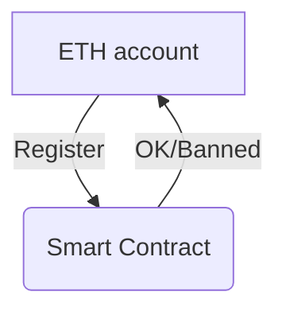
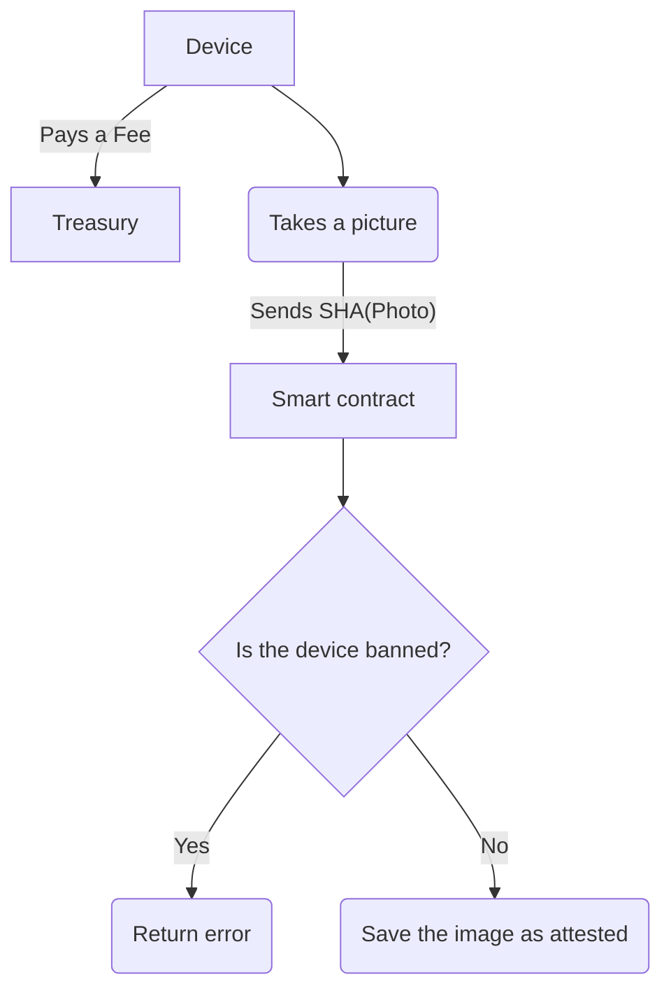
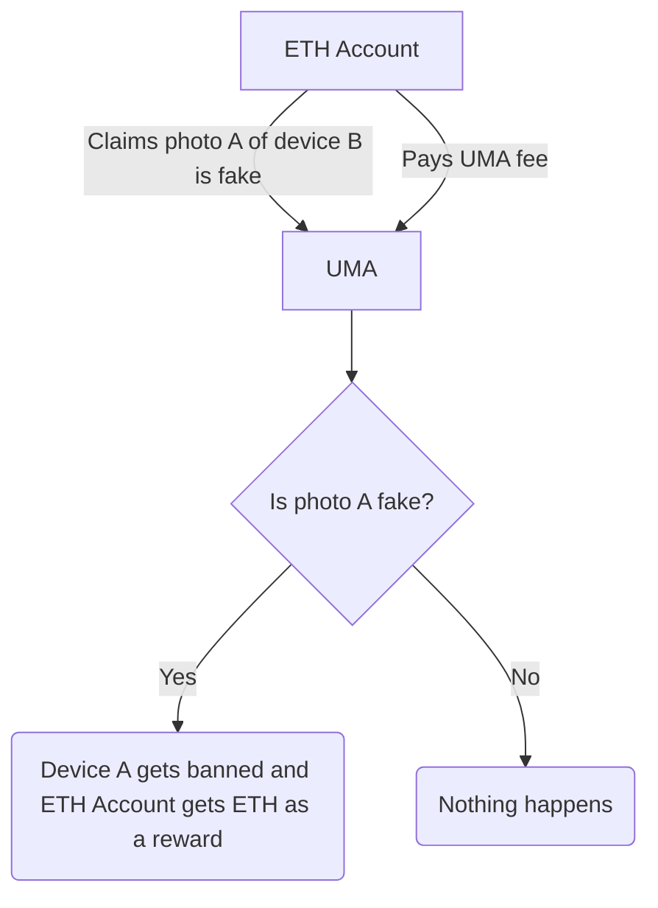

# Paprika protocol

> Original proposal, kept verbatim as received on 2026-11-20 (about 21:10 CET). Do not edit:
> reviews and revisions live elsewhere (`docs/`).

I have a protocol used to make attestation of digital photos as non-tampered, for example non-ai generated.

It needs to follow the requirements outlined in the slides, namely:

- Single point of failure
- Cross-platform lock-in
- retroactive censorship

The protocol works in 3 phases:

1. Device registration
2. Photo attestation
3. Device ban

## Device registration

To register a device, an Ethereum account needs to register it, with its own public key.
The registration fails if the device is banned.

## Photo attestation

The photo attestation works like this:

- The device takes a picture
- It asks for attestation to be recorded
- The smart contract saves the attestation if the device is not banned

## Device ban

- A user claims an irregural device exists
- The claim is checked in decentralized fashion (in this example using UMA but it could be something else)
- Ban and a reward are issued or not depending on the case

## Conclusions

This protocol is completely decentralized and relies on the economic incentives, it asks for fees to avoid spam.
