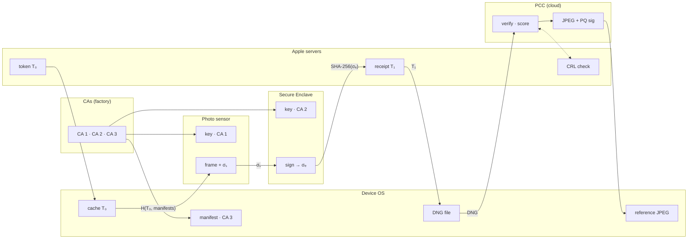

# IXH26 · Track 1 — Faithful transcription of the challenge deck

> **What this file is.** A slide-by-slide transcription of `track/original/track.pdf`
> (15 slides, raster images with **no text layer**). The wording of the slides is kept
> verbatim in English. Layout, colours, icons and figures are described in
> *[bracketed italics]*: those descriptions are the transcriber's, not the organisers'.
>
> **What this file is not.** It contains no interpretation. Interpretation lives in
> [`REQUIREMENTS.md`](REQUIREMENTS.md). Observations about ambiguities are confined to
> the last section, clearly separated.
>
> **Ground truth.** If this file and the images disagree, the images win:
> [`slides/slide-01.jpg`](slides/slide-01.jpg) … [`slides/slide-15.jpg`](slides/slide-15.jpg)
> (native 2046×1151 JPEG streams extracted losslessly from the PDF). In the PDF the
> slides are rotated 90° on A4 pages; the extracted images are upright.
>
> **Conventions.**
> - `**bold**` = bold on the slide. Whether an adjacent comma or colon is itself bold is approximate.
> - Maths tokens (T₀, T₁, σₛ, σₑ, SHA-256(σₑ), [T₀, T₁]) are **bold blue** on slides 6–7 and blue
>   italic in the slide 9 figure; here they are written plain, except where noted.
> - A dash "—" placed **between a card title and its body** is a joiner added by the transcriber:
>   on the slide the title and the body are on separate lines with no dash. The only real em
>   dashes in the deck are in slide 3 ("solution — but"), slide 8 ("Lists — if") and the slide 9
>   kicker ("OVERVIEW — ROWS").
> - Typographic apostrophes on the slides (device’s, frame’s, Apple’s) are written as straight `'`.
> - Every slide has the same footer, transcribed once here: left *[De Cifris seal]*
>   `DE COMPONENDIS CIFRIS`, right `IXH26 · TRACK 1 · BARI 2026`.

PDF metadata: title `slide-tracce`, 15 pages, created 2026-11-20 15:35 CET.
SHA-256 of the PDF: `ac8656124671b2a284e2a32dd8ef869460d3d6694acc33156201083512d52362`.

---

## Slide 1 — Crypto track · Ingredients

- Kicker: `IXH26 · NOVEMBER 2026`
- Title: **CRYPTO TRACK · INGREDIENTS**
- *[Three large cards in a row, joined by "+" signs]*
  1. *[purple card, key icon]* `01` **CRYPTOGRAPHY**
  2. *[yellow card, chain-link icon]* `02` **BLOCKCHAIN TECHNOLOGY**
  3. *[green card, camera icon]* `03` **DIGITAL PROVENANCE**

Reading of the figure: CRYPTOGRAPHY **+** BLOCKCHAIN TECHNOLOGY **+** DIGITAL PROVENANCE.

## Slide 2 — The synthetic reality dilemma

- Kicker: `THE PROBLEM`
- Title: **THE SYNTHETIC REALITY DILEMMA**
- *[Left card, pink, warning-triangle icon]*
  - Generative AI models produce photorealistic images, which are **indistinguishable from genuine camera captures.**
  - *[horizontal divider, then a badge reading `AND`]* **Modern cameras already post-process every image.**
- *[Arrow from the left card to the right card]*
- *[Right card, green]*
  - Small label: `A POSSIBLE SOLUTION`
  - **CRYPTOGRAPHIC GUARANTEES OF PHYSICAL ORIGIN.**

## Slide 3 — Apple Reference Image (a non-blockchain example)

- Kicker: `01 · EXAMPLE`
- Badge: `A NON-BLOCKCHAIN EXAMPLE`
- Title: **APPLE REFERENCE IMAGE**
- Text: Something concrete and close to a solution — but **centralised:** no decentralisation, no distribution, so weak to a single point of failure.
- *[Illustration on the right, purple background: a white card containing a stylised photo
  (mountains, sun) framed by four corner crop marks; below the photo a hand-drawn signature
  squiggle on a dashed line and a green circle with a check mark — i.e. "a signed, verified photo".]*

## Slide 4 — Main actors

- Kicker: `EXAMPLE · APPLE REFERENCE IMAGE`
- Title: **MAIN ACTORS**
- *[Left: a dashed-border green container]* **INSIDE THE MOBILE DEVICE** — badge: `HARDWARE BOUND`
  - **① PHOTO SENSOR** — Silicon chip signing raw pixels at light capture.
  - **② SECURE ENCLAVE (SEP)** — Isolated security chip holding keys and hardware attestation.
- *[Double-headed arrow ↔ between the device container and the two cards on the right]*
- *[Right, purple card]* **③ PRIVATE CLOUD COMPUTE (PCC)** — A privacy-preserving cloud, which executes verifiable operations on confidential data.
- *[Right, yellow card]* **④ FURTHER APPLE SERVICES** — Centralized RFC 3161 timestamping and key revocation servers.

## Slide 5 — Initialization & device manifest

- Kicker: `EXAMPLE · APPLE REFERENCE IMAGE · FACTORY PROVISIONING`
- Title: **INITIALIZATION & DEVICE MANIFEST**
- *[Three cards connected left-to-right by arrows]*
  - *[blue]* **① PHOTO-SENSOR KEYS** — Generates an ECDSA key pair coupled with a certificate from **CA 1**.
  - → *[purple]* **② SECURE-ENCLAVE (SEP) KEYS** — Produces its own key pair certified independently by **CA 2**.
  - → *[yellow]* **③ SIGNED DEVICE MANIFEST** — Keys and certificates are bundled into a device manifest signed by **CA 3**.
- *[Full-width green bar, chain-link icon, badge `HARDWARE BINDING`]* This triple-certified device manifest permanently binds the specific camera sensor silicon to the device's Secure Enclave before leaving the factory.

## Slide 6 — Creating a secure digital negative (1/2)

- Kicker: `EXAMPLE · APPLE REFERENCE IMAGE · CAPTURE MODE I · PHASE 1 (1/2)`
- Title: **CREATING A SECURE DIGITAL NEGATIVE**
- *[Full-width yellow bar]* **⓪ Lower-bound timestamp T₀:** signed timestamp tokens are regularly delivered to the device. The most recent one, T₀, is cached.
- *[Two white cards connected by an arrow]*
  - **① SENSOR REBOOT & PRE-CAPTURE INPUT** — Sensor reboots into a secure mode and accepts only one external input: the digest of T₀, Device Manifest and Secure Boot Manifest (the OS/firmware state was untampered at boot).
  - → **② SENSOR RAW CAPTURE & SIGNATURE** — The photo sensor produces the raw frame and places the received digest into a slot of the frame's internal metadata. *[new paragraph]* It produces an ECDSA signature σₛ on the raw frame and metadata.

## Slide 7 — Creating a secure digital negative (2/2)

- Kicker: `EXAMPLE · APPLE REFERENCE IMAGE · CAPTURE MODE II · PHASE 1 (2/2)`
- Title: **CREATING A SECURE DIGITAL NEGATIVE**
- *[Two white cards connected by an arrow]*
  - **③ SEP BINDING** — SEP signs a digest of σₛ combined with OS-captured metadata, producing σₑ.
  - → **④ UPPER-BOUND TIMESTAMP T₁** — The device sends **SHA-256(σₑ)** to Apple's timestamp service to obtain a signed T₁ receipt.
- *[Full-width green bar: step number, then a badge, then the text]* **⑤** `DNG PACKAGING` Raw frame, σₛ, σₑ, time window **[T₀, T₁]**, metadata and manifests are bundled into a DNG file (digital negative).

## Slide 8 — Creation of the reference image

- Kicker: `EXAMPLE · APPLE REFERENCE IMAGE · OFF-DEVICE ATTESTATION · PHASE 2`
- Title: **CREATION OF THE REFERENCE IMAGE**
- *[Three white cards connected by arrows]*
  - **① VERIFICATION** — PCC verifies digests, signatures, CA chains and same-device SEP-sensor binding.
  - → **② JPEG GENERATION** — PCC runs the verified raw frame through its image pipeline to produce the JPEG.
  - → **③ CONFIDENCE SCORE** — PCC computes an authenticity score of sensor and pipeline integrity.
- *[Full-width green bar, padlock icon]* **Hybrid PQ Signature:** the digest of the JPEG and its metadata is signed with a hybrid post-quantum signature (ML-DSA-87 + RSA-3072), embedded in the JPEG file.
- *[Full-width pink bar, warning-triangle icon]* **Revocation Alert:** verification relies on Apple's central Certificate Revocation Lists — if a sensor or CA key is revoked or the central server is unreachable, attestation fails.

## Slide 9 — Who does what, and when (overview diagram)

- Kicker: `EXAMPLE · APPLE REFERENCE IMAGE · OVERVIEW — ROWS ARE ACTORS, TIME FLOWS LEFT TO RIGHT`
- Title: **WHO DOES WHAT, AND WHEN**

*[The slide is a swim-lane diagram. Six horizontal lanes (actors), three time columns
separated by vertical dashed lines. Below: every box and every arrow, in time order.]*

**Lanes (top to bottom):** `CAs (factory)` · `Photo sensor` · `Secure Enclave` · `Device OS` · `Apple servers` · `PCC (cloud)`

**Columns (left to right):** `FACTORY` · `PHASE 1 · CAPTURE` · `PHASE 2 · ATTESTATION`

| # | Column | From (lane → box) | Arrow label | To (lane → box) |
|---|--------|-------------------|-------------|-----------------|
| 1 | FACTORY | CAs (factory) → `CA 1 · CA 2 · CA 3` | — | Photo sensor → `key · CA 1` |
| 2 | FACTORY | CAs (factory) → `CA 1 · CA 2 · CA 3` | — | Secure Enclave → `key · CA 2` |
| 3 | FACTORY | CAs (factory) → `CA 1 · CA 2 · CA 3` | — | Device OS → `manifest · CA 3` |
| 4 | PHASE 1 | Apple servers → `token T₀` | — | Device OS → `cache T₀` |
| 5 | PHASE 1 | Device OS → `cache T₀` | `H(T₀, manifests)` | Photo sensor → `frame + σₛ` |
| 6 | PHASE 1 | Photo sensor → `frame + σₛ` | `σₛ` | Secure Enclave → `sign → σₑ` |
| 7 | PHASE 1 | Secure Enclave → `sign → σₑ` | `SHA-256(σₑ)` | Apple servers → `receipt T₁` |
| 8 | PHASE 1 | Apple servers → `receipt T₁` | `T₁` | Device OS → `DNG file` |
| 9 | PHASE 1→2 | Device OS → `DNG file` | `DNG` | PCC (cloud) → `verify · score` |
| 10 | PHASE 2 | PCC (cloud) → `verify · score` | *(dashed, double-headed)* | Apple servers → `CRL check` |
| 11 | PHASE 2 | PCC (cloud) → `verify · score` | — | PCC (cloud) → `JPEG + PQ sig` |
| 12 | PHASE 2 | PCC (cloud) → `JPEG + PQ sig` | — | Device OS → `reference JPEG` |

Box colours: `CA 1 · CA 2 · CA 3` yellow; `frame + σₛ` and `sign → σₑ` purple; `token T₀`
and `receipt T₁` orange; `CRL check` pink; `DNG file`, `verify · score`, `JPEG + PQ sig`
green; `key · CA 1`, `key · CA 2`, `manifest · CA 3`, `cache T₀`, `reference JPEG` white.

The same diagram as a Mermaid flowchart (a redraw for machine readers, not an image from the
deck): one subgraph per lane, the 14 boxes as nodes, the 12 arrows as edges, labels only where the
slide has them. Time columns are not expressible here: use the table above for them. **If the
redraw and the table disagree, the table wins.**

Not described above: each lane has a pale background tint (Photo sensor and Secure Enclave lilac,
Apple servers pale orange, PCC pale green, CAs and Device OS off-white).

## Slide 10 — Cons of a centralised system

- Kicker: `EXAMPLE · APPLE REFERENCE IMAGE · LIMITS`
- Title: **CONS OF A CENTRALISED SYSTEM**
- *[Three cards]*
  - *[pink, warning-triangle icon]* **SINGLE POINT OF FAILURE** — Apple maintains central revocation lists. A compromised CA invalidates millions of devices.
  - *[orange, padlock icon]* **CROSS-PLATFORM LOCK-IN** — Non-Apple devices cannot natively verify claims without relying on Apple servers.
  - *[yellow, clock icon]* **RETROACTIVE CENSORSHIP** — Historic photos become unverifiable if central servers shut down or alter public keys.

## Slide 11 — The hackathon challenge

- Kicker: `02 · THE HACKATHON CHALLENGE`
- *[Left half, solid green panel]* Title: **UNIVERSAL PHOTO-ORIGIN VALIDATION PROTOCOL**
- *[Right half]* Small label: `ARCHITECTURAL SCOPE`
- Text, one phrase per line, alternating bold and regular:
  **Design a secure protocol** that generalises to **any device** and guarantees **authentic photo origin** via **decentralised blockchains** technology

As one sentence: "**Design a secure protocol** that generalises to **any device** and guarantees **authentic photo origin** via **decentralised blockchains** technology".

## Slide 12 — The rules: you can use

- Kicker: `THE RULES`
- Title: **YOU CAN USE**
- *[Left card, purple, globe icon]* **Anything you find on the Internet,** not subject to copyright limitation for non-profit use.
- *[Right card, white]* **Any cryptographic primitive/protocol**, such as
  - *[blue tile, key icon]* Standard public/symmetric keys
  - *[purple tile, magnifier icon]* Functional/searchable encryption
  - *[green tile, padlock icon]* (Fully) Homomorphic Encryption
  - *[orange tile, people icon]* Secure multiparty protocols
  - *[yellow full-width tile, light-bulb icon]* **Any other advanced cryptosystem…**
- *[Bottom line, badge `REFERENCE`; the whole line is bold, the URL is also underlined]* **Apple Reference Image documentation: security.apple.com/blog/apple-reference-image ↗**

## Slide 13 — AI policy: you can use AI

- Kicker: `ARTIFICIAL INTELLIGENCE POLICY & MANDATORY DISCLOSURE`
- Title: **YOU CAN USE AI**
- *[Full-width green bar, verified-badge icon]* **ALLOWED WITH FULL TRANSPARENCY** — You are free to use any AI software (LLMs, code assistants, visual generators), but you **must explicitly declare** which tool was used, how, and where:
- *[Three white cards]*
  - *[purple circle, `</>` icon]* **SOLUTION DESIGN & CODE GENERATION** — Specify approaches, algorithms or smart contracts generated via AI.
  - *[yellow circle, book icon]* **DOCUMENTATION** — Declare assistance in writing specifications or slides.
  - *[blue circle, chat-bubble icon]* **PITCH PREPARATION** — Detail AI involvement in slide creation or speech drafting.

## Slide 14 — Evaluation: how we rate your work

- Kicker: `EVALUATION`
- Title: **HOW WE RATE YOUR WORK**
- *[Three stacked bars on the left]*
  - *[purple]* **① EFFECTIVENESS** — Solution quality, blockchain interaction and closeness to real-world deployment.
  - *[yellow]* **② CRYPTO VISION** — Novelty and soundness of crypto ideas vs feasibility.
  - *[green]* **③ THE PITCH** — Clarity of presentation, defense and vision.
- *[White card on the right]* `MENTORS AND JUDGES`
  - **PhD Andrea Gangemi** — `SHUNYAXIFRA`
  - **Gabriele Radici** — `UNIVERSITY of TRENTO`
  - **PhD Francesco Romeo** — `UNIVERSITY of CASSINO`
  - **Prof. Roberto La Scala** — `UNIVERSITY of BARI`

## Slide 15 — Good luck

- Kicker: `IXH26 · TRACK 1`
- Title: **GOOD LUCK TO ALL IXH26 TEAMS!**
- *[Boxed line, chat-bubble icon]* **For any doubt, ask the IXH mentors!**
- `ORGANISED BY` — De Componendis Cifris
- `WEBSITE` — www.decifris.it *[underlined link]*
- *[Right: the De Cifris seal on a white disc (the slide background is yellow): a cipher disk with
  two concentric rings of glyphs (outer ring capitals and the digits 1–4, inner ring lowercase,
  in a blackletter face not transcribed here), a laurel wreath, a helmeted head, a star and
  "DE CIFRIS" in the centre.]*

---

## Transcriber's observations (not part of the deck)

These are ambiguities or oddities noticed while transcribing. They are flagged, not resolved.

1. **Slides 6–7 kickers** read `CAPTURE MODE I · PHASE 1 (1/2)` and `CAPTURE MODE II · PHASE 1 (2/2)`.
   The two slides describe one continuous sequence (steps ⓪–⑤), so "I/II" looks like pagination
   rather than two distinct capture modes. Unconfirmed.
2. **Slide 9, `H(T₀, manifests)`**: "manifests" is plural; slide 6 names the Device Manifest and
   the Secure Boot Manifest.
3. **Revocation wording.** Slide 8 says "Certificate Revocation Lists", slide 9 has a box
   "CRL check", slide 10 says "central revocation lists". Apple's own text speaks of
   revocation lists of *photo GUIDs and sensors*, fetched by devices and checked on-device
   (see [`reference/apple-reference-image.md`](reference/apple-reference-image.md)). The deck's
   wording is the organisers' simplification.
4. **Slide 11** says "decentralised **blockchains** technology" (plural "blockchains"). Whether
   this hints at multi-chain designs or is a typo is unknown.
5. **Slide 12** says "not subject to copyright limitation for non-profit use" — an imprecise
   phrase; the official event rules add that third-party software/IP may be used "if you have a
   licence" and must be mentioned in the submission (see `REQUIREMENTS.md`).
6. **Slide 7 vs slide 9.** Slide 7 says "The device sends SHA-256(σₑ)"; the slide 9 figure draws
   that arrow starting from the Secure Enclave box. Both are transcribed as they appear.
7. The deck never names a specific blockchain. The event itself is the *Italian XRPL Hackathon*
   (see `REQUIREMENTS.md`, section "Event context").
